 <div align="center">

<a href="https://farazkh.dev">
  
</a>


<br/>

<a href="https://farazkh.dev"></a>
<a href="https://github.com/farazkayan?tab=repositories"></a>
<a href="https://www.linkedin.com/in/faraz-kayan-haque-6b70253aa/"></a>

<br/><br/>

*Student · Builder · Homelab Nerd · Curious Human*

</div>

---

<div align="center">

### `01` &nbsp; THE PERSON BEHIND THE PROJECTS

</div>

I'm Faraz — a student who's genuinely obsessed with figuring out how technology works.

I learn by building things, breaking them, debugging the mess, and trying again. My interests range from web development and AI to Linux, networking, hardware, and self-hosting.

Most of my projects start with one question:

> **"Wait... why doesn't this exist?"**

And then, naturally, I try to build it myself.

---

<div align="center">

### `02` &nbsp; MY TECH WORLD


<br/>

`SOFTWARE` &nbsp;·&nbsp; `AI / LLMs` &nbsp;·&nbsp; `LINUX` &nbsp;·&nbsp; `NETWORKING` &nbsp;·&nbsp; `SELF-HOSTING`

</div>

I like experimenting across the stack — from making an interface feel right to understanding the systems running behind it.

I'm still learning. That's the point.

---

<div align="center">

### `03` &nbsp; THINGS I'VE BUILT

*Ideas are nice. Working implementations are better.*

</div>

<table>
<tr>
<td width="50%" valign="top">

<h3><a href="https://farazkh.dev">farazkh.dev ↗</a></h3>

My little corner of the internet.

A home for my projects, experiments, homelab setup, and everything I want to share with the world.

<br/>

<code>REACT</code> &nbsp; <code>WEB</code>

</td>
<td width="50%" valign="top">

<h3><a href="https://github.com/farazkayan/SoundMesh">SoundMesh ↗</a></h3>

An experiment in synchronizing audio playback across devices.

Exploring how multiple devices can work together to create one listening experience.

<br/>

<code>FLUTTER</code> &nbsp; <code>DART</code>

</td>
</tr>
<tr>
<td colspan="2" valign="top">

<h3><a href="https://github.com/farazkayan?tab=repositories">More experiments ↗</a></h3>

Tools, experiments, unfinished ideas, and whatever else catches my curiosity. There's always something new to figure out.

</td>
</tr>
</table>

<div align="center">

<a href="https://github.com/farazkayan?tab=repositories">

</a>

</div>

---

<div align="center">

### `04` &nbsp; THE HOMELAB

*Why just use technology when you can run it yourself?*


</div>

My homelab is where I experiment with Linux servers, self-hosted applications, media, networking, tunnels, automation, and remote access.

It's not a massive server rack. It's a place to experiment, learn how infrastructure works, and make useful things run on hardware I already have.

```text
  💡  IDEA
   │
   ▼
  🔨  BUILD
   │
   ▼
  💥  SOMETHING BREAKS
   │
   ▼
  🔎  DEBUG
   │
   ▼
  🧠  UNDERSTAND WHY
   │
   ▼
  🚀  IT WORKS
   │
   └──────────────► "Okay, what else can I run?"
```

---

<div align="center">

### `05` &nbsp; GITHUB, IN NUMBERS

*Some stats. Some patterns. An ongoing collection of commits.*

<br/>

<a href="https://github.com/farazkayan">
  
</a>
<a href="https://github.com/farazkayan">
  
</a>

<br/><br/>


</div>

---

<div align="center">

### `06` &nbsp; THE ACTIVITY FEED

*Every little square has a story. The graph tracks the work.*

<a href="https://github.com/farazkayan">
  
</a>

<br/><br/>


<br/>

<sub>Activity visuals generated automatically with GitHub Actions.</sub>

</div>

---

<div align="center">

### `07` &nbsp; OUTSIDE THE TERMINAL

<a href="https://www.instagram.com/faraz_kayan_haque/"></a>
<a href="https://www.linkedin.com/in/faraz-kayan-haque-6b70253aa/"></a>
<a href="https://www.facebook.com/faraz.kayan.haque/"></a>

<br/><br/>

*I don't need to know everything.*

*I just need to stay curious enough to figure it out.*

<br/>

**Explore. Experiment. Build. Break. Learn. Repeat.**

<br/>

<a href="https://farazkh.dev">
  
</a>

<br/><br/>


</div>
